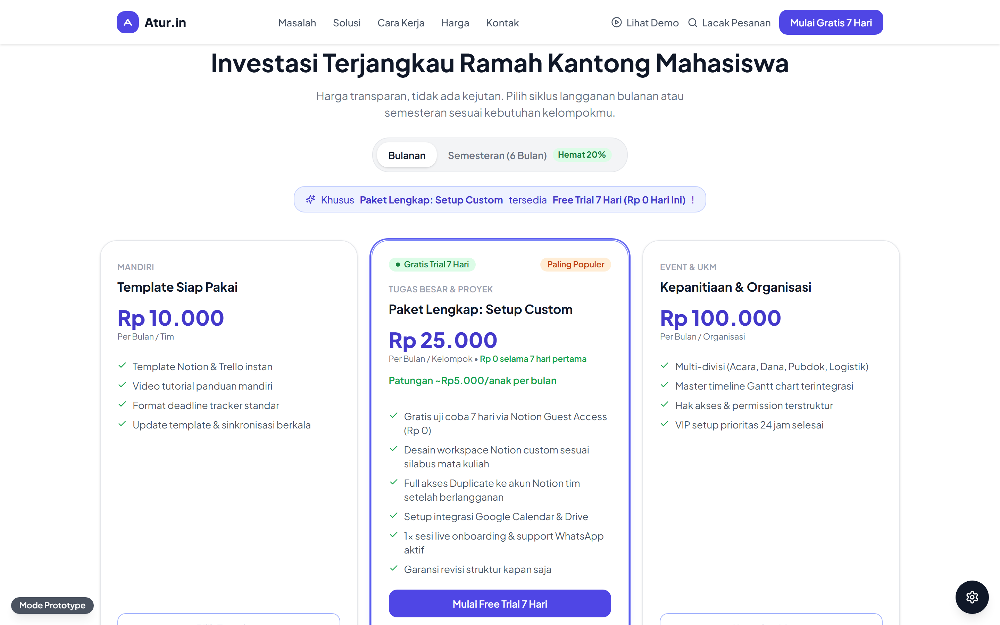
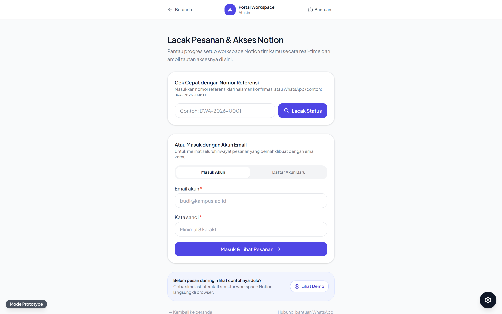
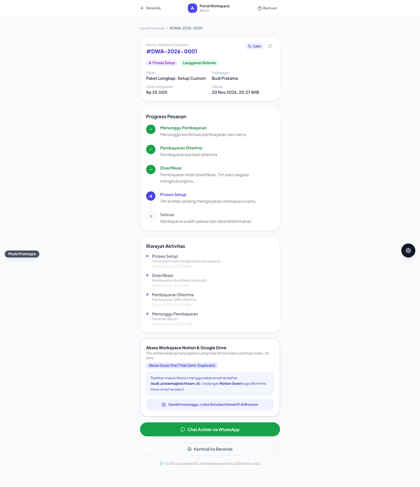
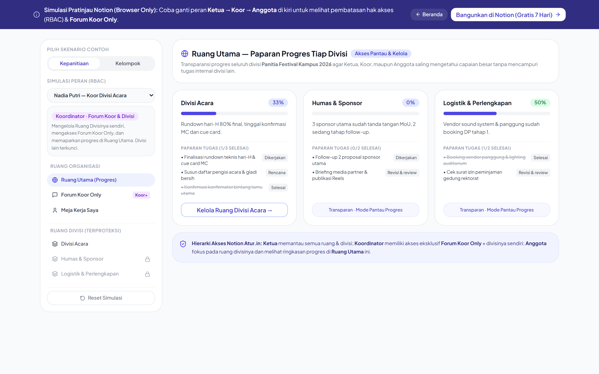

# 3.3 Hasil Mock Up

Subbab ini menyajikan rancangan antarmuka (*high-fidelity mock up*), fitur utama, dan alur pengguna aplikasi web **Atur.in (Digital Workspace Architect)**. Atur.in dirancang sebagai layanan perancangan ruang kerja digital berbasis **Notion dan Google Drive** dengan skema **Free Trial 7 Hari Anti-Jiplak (*Notion Guest Access*)**, **Simulasi Interaktif 100% *client-side* (`/demo`)** yang tidak membebani database server, serta pemisahan jalur UX yang tegas antara **Lihat Demo**, **Lacak Pesanan**, **Checkout**, dan **Panel Admin**.

## 3.3.1 Arsitektur Alur Pengguna (*End-to-End User Flow*)

*Gambar 3.1 Arsitektur Alur Pengguna End-to-End Aplikasi Atur.in*

Gambar 3.1 memetakan alur sistem secara menyeluruh dari halaman Beranda hingga serah terima ruang kerja Notion. Calon pengguna dapat mencoba simulasi terlebih dahulu melalui `/demo` atau langsung memesan lewat `/checkout` dengan dua jalur: **Jalur Free Trial 7 Hari (Rp 0)** menggunakan mekanisme *Notion Guest Access (Can Edit, Anti-Duplicate)* yang beralih ke *Full Duplicate* setelah pelunasan, serta **Jalur Paket Berbayar** melalui pembayaran multi-metode. Seluruh progres setup dan tautan akses Notion dikelola oleh Admin dan disinkronkan secara *real-time* ke halaman Lacak Pesanan klien.

## 3.3.2 Halaman Beranda (*Landing Page* & Pilihan Paket Harga)

*Gambar 3.2 Tampilan Hero Halaman Beranda Atur.in*

*Gambar 3.3 Pilihan Paket Harga dan Toggle Siklus Langganan*

Halaman Beranda (`/`) memperkenalkan proposisi nilai Atur.in dengan navigasi terpisah yang jelas antara **Lihat Demo**, **Lacak Pesanan**, dan **Mulai Gratis 7 Hari**. Pengguna langsung melihat pratinjau papan Kanban serta pilihan paket (*Template Siap Pakai* Rp 10.000/bln, *Setup Custom* Rp 25.000/bln dengan **Free Trial 7 Hari via Notion Guest Access**, *Kepanitiaan & Organisasi* Rp 100.000/bln, dan *Paket Organisasi Pro* Rp 499.000/bln) lengkap dengan *toggle* siklus Bulanan vs Semesteran (hemat 20%).

## 3.3.3 Halaman Checkout — Info Singkat Tim

*Gambar 3.3 Mock Up Halaman Checkout — Pengisian Info Singkat Tim*

Halaman Checkout (`/checkout`) menerapkan prinsip *Minimum Path to Value* dengan **stepper adaptif** (3 langkah untuk Free Trial dan 4 langkah untuk paket berbayar) serta hanya mewajibkan 5 data inti (Nama, Email, WhatsApp, Nama Tim, Jenis Kebutuhan), sementara detail tambahan disembunyikan di *accordion* opsional. Tersedia tombol **Isi Cepat (Data Contoh)** untuk mempermudah pengujian serta kotak informasi transparan mengenai proteksi *Notion Guest Access (Anti-Duplicate)* selama masa uji coba 7 hari.

## 3.3.4 Halaman Pembayaran & Konfirmasi Selesai

*Gambar 3.4 Mock Up Halaman Pembayaran (Kiri) dan Konfirmasi Selesai (Kanan)*

Untuk pesanan berbayar, halaman Pembayaran (`/checkout/pembayaran/:id`) mendukung tiga metode (**QRIS Instan**, **Virtual Account**, dan **E-Wallet**) lengkap dengan *countdown timer*, *polling* status otomatis tiap 3 detik, dan tombol **Simulasikan Bayar Lunas (1-Klik)** pada mode prototype. Setelah terkonfirmasi, halaman Selesai (`/checkout/selesai/:id`) menampilkan nomor referensi unik (`DWA-2026-XXXX`), fitur cetak **Invoice PDF resmi**, serta kartu akses **Workspace Notion Tim**.

## 3.3.5 Halaman Lacak Pesanan Bersih (`/lacak-pesanan`)

*Gambar 3.5 Mock Up Halaman Lacak Pesanan Bersih (/lacak-pesanan)*

Halaman Lacak Pesanan (`/lacak-pesanan`) dipisahkan sepenuhnya dari mode demo agar fokus melayani klien yang sudah memesan. Klien dapat langsung melacak progres menggunakan **Nomor Referensi** tanpa login, atau masuk menggunakan **Akun Email** untuk melihat riwayat pesanan dan pintasan langsung ke tautan Notion; sedangkan pengunjung baru diarahkan melalui tautan khusus menuju halaman `/demo`.

## 3.3.6 Halaman Status Pesanan (*Real-Time*)

*Gambar 3.6 Mock Up Halaman Status Pesanan Real-Time (/lacak-pesanan/:id)*

Halaman Status Pesanan (`/lacak-pesanan/:id`) menyajikan **Timeline 5 Tahap** (*Menunggu Pembayaran → Dibayar → Diverifikasi → Proses Setup → Selesai*) yang diperbarui otomatis setiap 30 detik beserta riwayat aktivitas berstempel waktu WIB. Pada halaman ini juga tertanam pusat akses permanen berupa tombol **Buka Workspace di Notion**, **Folder Google Drive**, pengingat login email terdaftar bagi pengguna *Notion Guest Trial*, serta tombol upgrade ke langganan penuh.

## 3.3.7 Simulasi Interaktif (`/demo`) — Hierarki RBAC 3 Tingkat & Ruang Utama Transparan

*Gambar 3.7 Mock Up Simulasi Interaktif (/demo) — Ruang Utama Transparan & Sidebar RBAC*

Halaman `/demo` berjalan **100% *client-side*** di browser (`localStorage`, tanpa beban database server) untuk memperagakan struktur Notion Atur.in pada skenario *Kepanitiaan* dan *Kelompok Kuliah*. **Ruang Utama** dirancang 100% transparan dengan menampilkan persentase dan rincian progres tugas seluruh divisi agar semua anggota saling mengetahui perkembangan acara, sementara hak akses dikendalikan melalui hierarki 3 tingkat berikut:

| Peran (*Role*) | Ruang Utama (Progres Semua Divisi) | Forum Koor Only | Ruang Divisi Sendiri | Ruang Divisi Lain (Edit) |
| :--- | :---: | :---: | :---: | :---: |
| **Ketua Pelaksana / Ketua Kelompok** | Transparan + Kelola Semua | Akses Penuh | Semua Divisi | Akses Penuh |
| **Koordinator Divisi (Koor)** | Transparan (Mode Pantau) | **Eksklusif (Penuh)** | Akses Penuh | Terkunci (`🔒`) |
| **Anggota Divisi** | Transparan (Mode Pantau) | Terkunci (`🔒`) | Akses Penuh | Terkunci (`🔒`) |

## 3.3.8 Forum Koor Only (Reply Thread) & Meja Kerja Pribadi

*Gambar 3.8 Mock Up Forum Koor Only (Reply Thread) & Meja Kerja Pribadi*

**Forum Koor Only** menyediakan ruang diskusi strategis khusus Ketua dan para Koordinator dengan fitur **Reply Thread** (menyerupai *Notion Comments*) agar pembahasan rapat dan eskalasi lintas divisi terkelompok rapi per topik tanpa tenggelam di grup WhatsApp. Sementara itu, **Meja Kerja Pribadi** memfokuskan tugas dan *checklist* harian individu, dan sistem otomatis menampilkan layar proteksi akses apabila Anggota mencoba membuka *Forum Koor Only* atau ruang internal divisi lain.

## 3.3.9 Panel Admin — Dashboard KPI, Serah Terima Link Notion, & Notifikasi Otomatis

*Gambar 3.9 Mock Up Panel Admin — Dashboard KPI, Serah Terima Link Notion, & Notifikasi Otomatis*

Panel Admin (`/admin/*`, dilindungi `AdminGuard` JWT) menyajikan 8 kartu KPI *real-time* (Total Pesanan, Revenue, Free Trial Aktif, Menunggu Bayar, Proses Setup, Selesai, Pengguna, dan Leads) serta tabel pemantauan pesanan. Pada detail pesanan, Admin dapat memperbarui status, menempelkan **Link Notion & Google Drive** beserta tipe hak akses (*Guest Trial Anti-Duplicate* vs *Hak Milik Penuh*), lalu menekan tombol 1-klik **Kirim Notifikasi Selesai ke WA Klien** atau **Buka Draft Email** yang langsung terisi pesan template otomatis.
