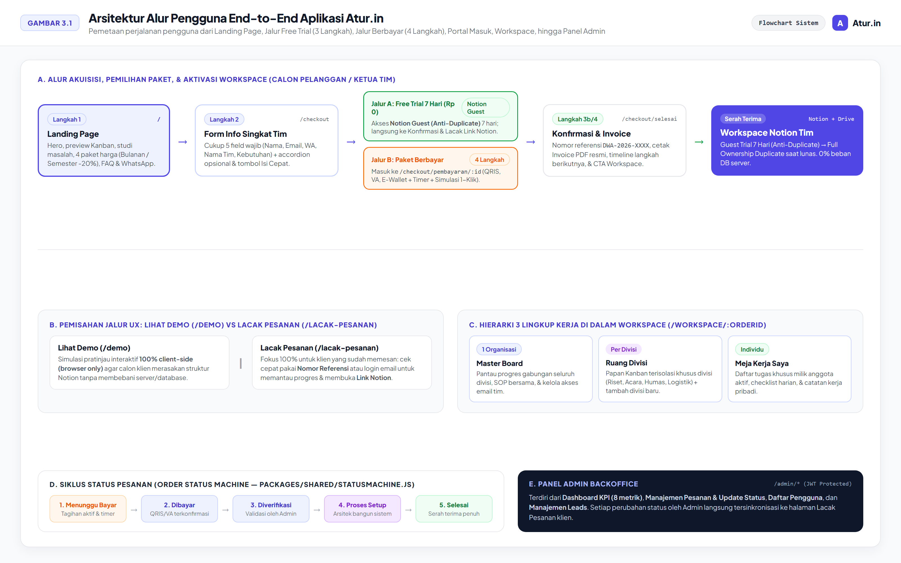
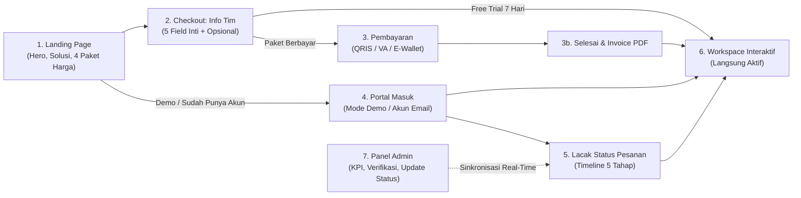
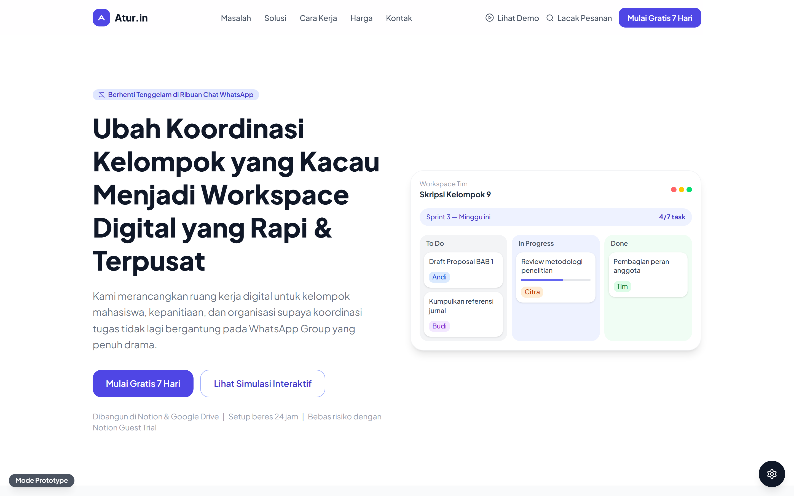
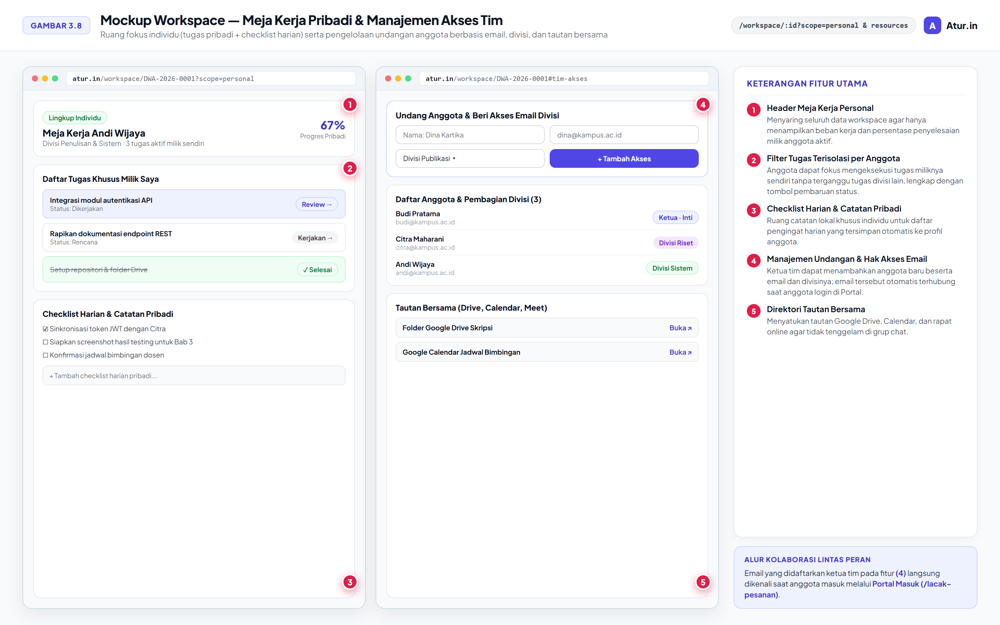
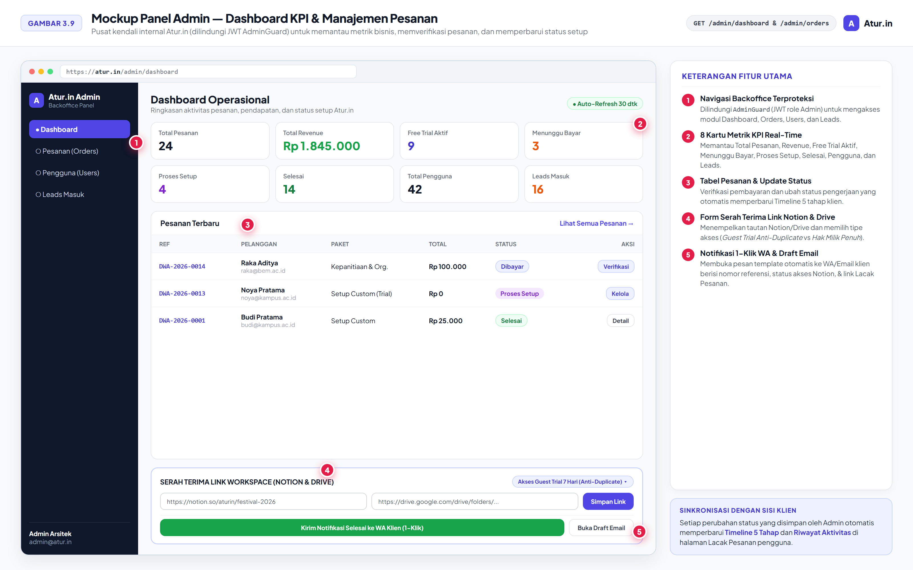

# 3.3 Hasil Mock Up

Subbab ini menyajikan rancangan antarmuka (*high-fidelity mock up*) aplikasi web **Atur.in (Digital Workspace Architect)** beserta penjelasan fitur utama dan alur interaksi pengguna (*user flow*) secara menyeluruh. Perancangan antarmuka mengacu pada sistem desain yang konsisten — menggunakan tipografi *Plus Jakarta Sans*, palet warna utama Indigo (`#4f46e5`) dengan permukaan netral (`#ffffff` dan `#f9fafb`), serta 100% berbahasa Indonesia — dengan menerapkan prinsip *Minimum Path to Value* (MPTV), *Hick's Law*, *One Source of Navigation*, dan *Endowed Progress* agar pengguna dapat segera merasakan manfaat ruang kerja digital dengan hambatan minimal.

---

## 3.3.1 Arsitektur Alur Pengguna (*End-to-End User Flow*)

Secara keseluruhan, alur penggunaan aplikasi Atur.in terbagi menjadi lima tahapan utama yang saling terintegrasi, mulai dari halaman pengenalan produk (*Landing Page*), proses pemesanan (*Checkout* dan Pembayaran), Portal Masuk & Pelacakan Pesanan, Ruang Kerja Kolaborasi (*Workspace*), hingga Panel Admin untuk pengelolaan operasional.

*Gambar 3.1 Arsitektur Alur Pengguna End-to-End Aplikasi Atur.in*

Penjelasan alur utama pada **Gambar 3.1**:
1. **Jalur Free Trial 7 Hari — Notion Guest Access (3 Langkah)**: Pengguna memilih paket *Setup Custom* dengan opsi uji coba gratis (Rp 0) di Landing Page → mengisi 5 data inti di halaman Checkout → masuk ke Halaman Konfirmasi Selesai & Lacak Pesanan. Selama 7 hari, tim diundang sebagai **Notion Guest (Can Edit)** di ruang *host* Atur.in dengan proteksi **Anti-Duplicate & Anti-Export** (sehingga aman dari penjiplakan). Apabila cocok dan melanjutkan langganan, hak **Full Duplicate** ke akun Notion tim langsung dibuka.
2. **Jalur Paket Berbayar (4 Langkah)**: Pengguna memilih paket berbayar (*Template Siap Pakai*, *Setup Custom*, *Kepanitiaan & Organisasi*, atau *Paket Organisasi Pro*) → mengisi Info Tim → menyelesaikan pembayaran (QRIS, Virtual Account, atau E-Wallet) → menerima nomor referensi, bukti Invoice PDF, dan tautan akses **Workspace Notion & Google Drive** penuh.
3. **Pemisahan Jalur UX (`Lihat Demo` vs `Lacak Pesanan`)**: Calon pengguna yang ingin mencoba sebelum memesan diarahkan ke **Simulasi Interaktif (`/demo`)** yang berjalan 100% *client-side* di browser (0% beban database/server), sedangkan klien yang sudah memesan mengakses **Lacak Pesanan (`/lacak-pesanan`)** untuk memantau progres dan mengambil Link Notion.
4. **Sinkronisasi Panel Admin**: Tim internal Atur.in memverifikasi pembayaran, memperbarui status pengerjaan (*Menunggu Pembayaran → Dibayar → Diverifikasi → Proses Setup → Selesai*), serta menempelkan **Link Notion & Google Drive** (beserta tipe akses *Guest Trial* atau *Full Owner*) yang langsung aktif pada halaman Status Pesanan klien.

---

## 3.3.2 Mock Up Halaman Beranda (*Landing Page* & Pilihan Paket Harga)

Halaman Beranda (`GET /`) berfungsi sebagai pintu masuk utama untuk memperkenalkan proposisi nilai Atur.in, menampilkan permasalahan manajemen tugas kelompok yang sering tenggelam di grup chat, memperlihatkan pratinjau papan Kanban, serta menyajikan pilihan paket harga secara transparan.

*Gambar 3.2 Mock Up Halaman Beranda (Landing Page) dan Pilihan Paket Harga Atur.in*

**Penjelasan Fitur (sesuai nomor anotasi pada Gambar 3.2):**

| No | Elemen / Fitur | Penjelasan Fungsi |
| :-: | :--- | :--- |
| **1** | **Navigasi Terpisah & Anti-Bingung** | Menyediakan tautan seksi halaman dan memisahkan dengan tegas tombol **Lihat Demo** (`/demo`), **Lacak Pesanan** (`/lacak-pesanan`), serta CTA utama **Mulai Gratis 7 Hari**. |
| **2** | **Hero Value Proposition & Dual CTA** | Menyajikan kalimat nilai utama secara ringkas dengan dua jalur pilihan: langsung memulai **Free Trial 7 Hari** atau mencoba **Demo Interaktif** tanpa registrasi. |
| **3** | **Pratinjau Papan Kanban Interaktif** | Menampilkan ilustrasi langsung struktur kerja (*Rencana*, *Dikerjakan*, *Selesai*) sehingga calon pengguna langsung memahami bentuk luaran ruang kerja sebelum memesan. |
| **4** | **Toggle Siklus Langganan** | Memungkinkan pengguna beralih antara tarif **Bulanan** dan **Semesteran (6 bulan, hemat 20%)** dengan kalkulasi harga otomatis. |
| **5** | **4 Kartu Paket Harga & Highlight Populer** | Menampilkan 4 opsi paket: *Template Siap Pakai* (Rp 10.000/bln), *Setup Custom* (Rp 25.000/bln, ditandai **Paling Populer** + **Free Trial 7 Hari** & estimasi patungan ~Rp 5.000/anak), *Kepanitiaan & Organisasi* (Rp 100.000/bln), dan *Paket Organisasi Pro* (Rp 499.000/bln). |

**Alur Pengguna:** Pengguna meninjau solusi dan memilih salah satu paket harga, lalu sistem meneruskan parameter paket (`paket`, `cycle`, `trial`) secara otomatis ke **Halaman Checkout (`/checkout`)**. Jika pengguna menekan **Masuk / Demo**, sistem mengarahkan ke **Portal Masuk (`/lacak-pesanan`)**.

---

## 3.3.3 Mock Up Halaman Checkout — Pengisian Info Singkat Tim

Halaman Checkout (`GET /checkout`) dirancang mengikuti prinsip *Minimum Path to Value* (MPTV) agar pengguna tidak terbebani formulir panjang sebelum merasakan manfaat produk.

*Gambar 3.3 Mock Up Halaman Checkout — Pengisian Info Singkat Tim*

**Penjelasan Fitur (sesuai nomor anotasi pada Gambar 3.3):**

| No | Elemen / Fitur | Penjelasan Fungsi |
| :-: | :--- | :--- |
| **1** | **Stepper Adaptif (3 vs 4 Langkah)** | Menampilkan jumlah langkah secara akurat sesuai jenis pesanan: **3 langkah** untuk Free Trial (*Pilih Paket → Info Tim → Workspace Aktif*) dan **4 langkah** untuk paket berbayar (*dengan langkah Bayar*). |
| **2** | **Tombol Isi Cepat (Data Contoh)** | Fitur pendukung pengujian prototype dan evaluasi pengguna (SUS) untuk mengisi seluruh kolom wajib secara otomatis dalam 1 klik. |
| **3** | **5 Field Wajib Inti** | Hanya meminta 5 data esensial (Nama Lengkap, Email Aktif, No. WhatsApp berformat `+62`, Nama Kelompok/Organisasi, dan Jenis Kebutuhan) dilengkapi validasi format & *auto-save draft* otomatis. |
| **4** | **Accordion Detail Opsional** | Menerapkan *Progressive Disclosure* dengan menyembunyikan input opsional (jumlah anggota detail, deskripsi kebutuhan, dan unggah dokumen silabus) agar formulir utama tetap ringkas. |
| **5** | **Kartu Ringkasan Paket & Biaya** | Menampilkan rincian harga normal, potongan Free Trial (menjadi **Rp 0 hari ini**), informasi PPN, serta tombol ubah paket. |

**Alur Pengguna:** Setelah formulir divalidasi dan dikirim, sistem membuat entri pesanan beserta nomor referensi unik. Untuk pesanan **Free Trial (Notion Guest Access)**, pengguna diarahkan ke **Halaman Konfirmasi Selesai (`/checkout/selesai/:id`)** untuk memantau pengiriman Link Notion; sedangkan untuk pesanan **Berbayar**, pengguna dilanjutkan ke **Halaman Pembayaran (`/checkout/pembayaran/:id`)**.

---

## 3.3.4 Mock Up Halaman Pembayaran & Konfirmasi Pesanan Selesai

Untuk pesanan paket berbayar (atau pengguna Free Trial yang melakukan aktivasi langganan penuh), sistem menyediakan halaman pembayaran multi-metode (`GET /checkout/pembayaran/:orderId`) dan halaman konfirmasi selesai (`GET /checkout/selesai/:orderId`).

*Gambar 3.4 Mock Up Halaman Pembayaran (Kiri) dan Halaman Konfirmasi Selesai (Kanan)*

**Penjelasan Fitur (sesuai nomor anotasi pada Gambar 3.4):**

| No | Elemen / Fitur | Penjelasan Fungsi |
| :-: | :--- | :--- |
| **1** | **Countdown Timer Batas Pembayaran** | Menampilkan hitung mundur waktu aktif tagihan. Apabila waktu habis, sistem menampilkan status *Kedaluwarsa* beserta tombol pembaruan tagihan. |
| **2** | **Pemilih 3 Metode Pembayaran** | Mendukung **QRIS Instan**, **Virtual Account** (bank nasional), dan **E-Wallet** (GoPay/OVO/DANA) yang menghasilkan instruksi bayar secara dinamis. |
| **3** | **Polling Status & Simulasi Bayar 1-Klik** | Sistem memeriksa status transaksi ke server setiap 3 detik. Pada mode prototype, tersedia tombol **Simulasikan Bayar Lunas (1-Klik)** untuk keperluan demonstrasi dan pengujian alur. |
| **4** | **Kartu Bukti Transaksi & Cetak Invoice PDF** | Menampilkan nomor referensi unik (`DWA-2026-XXXX`) dengan tombol salin, ringkasan transaksi, serta fitur **Unduh/Cetak Bukti Invoice Resmi (PDF)**. |
| **5** | **Kartu Akses Workspace & Pintasan Pelacakan** | Menyediakan tombol utama **Buka Ruang Kerja Tim**, tautan **Lihat Status Pesanan**, dan tombol **Chat Arsitek via WhatsApp**. |

**Alur Pengguna:** Setelah pembayaran terkonfirmasi lunas (baik melalui *polling* otomatis maupun tombol simulasi), sistem memperbarui status pesanan menjadi `Dibayar` dan mengarahkan pengguna langsung ke **Workspace Aktif** atau **Halaman Selesai**.

---

## 3.3.5 Mock Up Portal Masuk (*Mode Demo Prototype* & Akun Email)

Halaman Portal Masuk (`GET /lacak-pesanan`) menerapkan *Hick's Law* dengan membagi akses ke dalam dua tab utama yang jelas: **Mode Demo Prototype** bagi pengunjung yang ingin langsung mencoba tanpa mendaftar, dan **Masuk / Daftar Akun** bagi anggota tim yang telah memiliki akses email.

*Gambar 3.5 Mock Up Portal Masuk — Mode Demo Prototype (Kiri) dan Akun Email (Kanan)*

**Penjelasan Fitur (sesuai nomor anotasi pada Gambar 3.5):**

| No | Elemen / Fitur | Penjelasan Fungsi |
| :-: | :--- | :--- |
| **1** | **Switcher 2 Mode Portal** | Memisahkan secara tegas antara **Mode Demo Prototype** (coba instan) dan **Masuk / Daftar Akun** (autentikasi email). |
| **2** | **Pemilih 2 Skenario Kasus Nyata** | Pengguna dapat memilih skenario **Kelompok Kuliah & Riset** (Skripsi/Tugas Besar) atau **Kepanitiaan & Organisasi** (Event Kampus/UKM). |
| **3** | **3 Kartu Persona Berbasis Lingkup** | Setiap skenario menyediakan 3 peran siap klik: **Ketua** (membuka *Lingkup 1 Organisasi*), **Koordinator** (membuka *Lingkup Divisi*), dan **Anggota** (membuka *Meja Kerja Individu*). |
| **4** | **Form Autentikasi Akun Email (JWT)** | Mendukung proses masuk (*login*) dan pendaftaran (*register*) menggunakan email yang telah didaftarkan ketua tim di dalam Workspace. |
| **5** | **Deteksi Otomatis Divisi & Pintasan** | Setelah login berhasil, sistem menampilkan daftar workspace terhubung, nama divisi & jabatan anggota, serta tombol langsung **Buka Divisi Saya** dan **Meja Kerja Saya**. |

**Alur Pengguna:** Klik salah satu kartu persona pada Mode Demo atau tombol workspace pada tab Akun akan langsung membuka **Workspace Interaktif (`/workspace/:id`)** pada lingkup kerja yang sesuai dengan peran pengguna.

---

## 3.3.6 Mock Up Halaman Lacak Status Pesanan (*Real-Time*)

Halaman Lacak Status Pesanan (`GET /lacak-pesanan/:orderId`) memberikan transparansi penuh atas perkembangan pesanan dan pengerjaan *custom setup* oleh tim arsitek Atur.in.

*Gambar 3.6 Mock Up Halaman Lacak Status Pesanan Real-Time*

**Penjelasan Fitur (sesuai nomor anotasi pada Gambar 3.6):**

| No | Elemen / Fitur | Penjelasan Fungsi |
| :-: | :--- | :--- |
| **1** | **Banner Masa Aktif Free Trial** | Menampilkan batas waktu berakhirnya uji coba gratis 7 hari serta tombol pintas **Bayar & Aktifkan Langganan Penuh**. |
| **2** | **Kartu Ringkasan Referensi & Refresh** | Memuat nomor referensi pesanan, lencana status aktif, detail paket, tombol salin referensi, dan tombol muat ulang (*refresh*) manual. |
| **3** | **Timeline 5 Tahap Status Pesanan** | Visualisasi progres otomatis (*auto-refresh* setiap 30 detik) mengikuti mesin status: `Menunggu Pembayaran → Pembayaran Diterima → Diverifikasi → Proses Setup → Selesai`. |
| **4** | **Riwayat Aktivitas (*Audit Trail*)** | Menampilkan kronologi perubahan status beserta catatan pengerjaan dari tim arsitek lengkap dengan waktu (WIB). |
| **5** | **CTA Workspace & Bantuan WhatsApp** | Memungkinkan pengguna langsung masuk ke Workspace atau menghubungi tim arsitek via WhatsApp dengan nomor referensi terisi otomatis. |

**Alur Pengguna:** Halaman ini terhubung secara langsung dengan data backend; setiap pembaruan status yang dilakukan oleh Admin akan tampil otomatis di sini tanpa perlu memuat ulang halaman secara manual.

---

## 3.3.7 Mock Up Simulasi Interaktif (`/demo`) — Pratinjau Struktur Notion

Halaman Simulasi Interaktif (`GET /demo`) berjalan **100% client-side di browser** (menggunakan `localStorage` tanpa menulis ke database server) sehingga tidak menimbulkan risiko *overload* server. Tujuannya adalah memberikan pengalaman pratinjau langsung mengenai struktur kerja (Master Board, Ruang Divisi, dan Meja Kerja Pribadi) yang akan dibangun oleh arsitek Atur.in di **Notion & Google Drive** tim klien.

*Gambar 3.7 Mock Up Simulasi Interaktif (/demo) — Pratinjau Struktur Workspace Notion*

**Matriks Hak Akses Hierarki 3 Tingkat (*Role-Based Access Control / RBAC*) yang diterapkan pada Struktur Workspace Notion:**

| Peran (*Role*) | Ruang Utama (Paparan Progres Tiap Divisi) | Forum Koor Only (Rapat Lintas Koor) | Ruang Divisi Sendiri (Kanban) | Ruang Divisi Lain |
| :--- | :---: | :---: | :---: | :---: |
| **Ketua Pelaksana / Ketua Kelompok** | Akses Penuh | Akses Penuh | Semua Divisi | Akses Penuh |
| **Koordinator Divisi (Koor)** | Akses Penuh | **Akses Penuh (Eksklusif)** | Akses Penuh | Terkunci |
| **Anggota Divisi** | Lihat Paparan (*Read-Only*) | Terkunci | Akses Penuh | Terkunci |

**Penjelasan Fitur (sesuai nomor anotasi pada Gambar 3.7):**

| No | Elemen / Fitur | Penjelasan Fungsi |
| :-: | :--- | :--- |
| **1** | **Switcher Profil Anggota (One Source)** | Kontrol pergantian identitas anggota diletakkan secara konsisten hanya di Sidebar untuk menghindari duplikasi tombol di area kanvas utama (*One Source of Navigation*). |
| **2** | **Navigasi Lingkup Kerja & Ruang Divisi** | Memungkinkan perpindahan instan antara **Semua Divisi (1 Organisasi)**, **Meja Kerja Saya**, daftar **Ruang per Divisi** (disertai fitur *+ Tambah Divisi*), dokumen **SOP Bersama**, dan menu **Tim & Akses Email**. |
| **3** | **Panduan Cepat 3 Langkah (*Endowed Progress*)** | Banner *dismissible* saat pengguna pertama kali masuk: langkah ke-1 otomatis tercentang (*Workspace siap digunakan*), sedangkan langkah 2 dan 3 tercentang otomatis saat pengguna memindahkan tugas Kanban dan berpindah lingkup kerja. |
| **4** | **Papan Kanban 4 Kolom Interaktif** | Mengelompokkan tugas ke dalam 4 status: **Rencana**, **Dikerjakan**, **Revisi & review**, dan **Selesai**. Mendukung *drag-and-drop* kartu maupun tombol pindah tahap cepat. |
| **5** | **Quick-Add Task & Penyimpanan Optimistis** | Pengguna dapat menambah tugas baru langsung dari kolom mana pun dengan penyimpanan otomatis (*optimistic update*) ke server API. |

**Alur Pengguna:** Dari Master Board, ketua tim dapat memantau progres keseluruhan, sementara koordinator atau anggota dapat mengklik nama divisinya di Sidebar untuk melihat papan Kanban yang terfilter khusus bagi divisinya, atau memilih **Meja Kerja Saya**.

---

## 3.3.8 Mock Up Workspace — Meja Kerja Pribadi & Manajemen Akses Tim

Selain papan Kanban lintas divisi, Workspace Atur.in menyediakan tampilan **Meja Kerja Pribadi** (`scope=personal`) untuk fokus individu serta halaman **Tim, Akses Email & Tautan** untuk mengelola kolaborasi anggota.

*Gambar 3.8 Mock Up Workspace — Meja Kerja Pribadi (Kiri) dan Manajemen Tim, Akses Email & Tautan (Kanan)*

**Penjelasan Fitur (sesuai nomor anotasi pada Gambar 3.8):**

| No | Elemen / Fitur | Penjelasan Fungsi |
| :-: | :--- | :--- |
| **1** | **Header & Indikator Progres Pribadi** | Menampilkan ringkasan nama anggota aktif, divisi asal, jumlah tugas aktif, serta persentase penyelesaian tugas individu. |
| **2** | **Daftar Tugas Terisolasi per Anggota** | Menyaring seluruh kartu Kanban agar hanya menampilkan tugas yang ditugaskan kepada anggota tersebut, lengkap dengan tombol pembaruan status cepat. |
| **3** | **Checklist Harian & Catatan Pribadi** | Ruang daftar periksa personal yang tersimpan terpisah untuk membantu anggota mencatat tindak lanjut harian di luar papan utama tim. |
| **4** | **Manajemen Undangan & Hak Akses Email** | Ketua tim dapat menambahkan anggota baru beserta alamat email dan divisinya. Email yang didaftarkan otomatis terhubung ke divisi terkait saat anggota login di Portal Masuk. |
| **5** | **Direktori Tautan Bersama** | Pusat penyimpanan tautan eksternal penting (Google Drive, Google Calendar, ruang rapat daring) agar mudah diakses seluruh anggota tanpa tenggelam di grup chat. |

---

## 3.3.9 Mock Up Panel Admin — Dashboard KPI & Manajemen Pesanan

Panel Admin (`GET /admin/dashboard` dan `/admin/orders`) merupakan antarmuka internal (*backoffice*) yang dilindungi autentikasi JWT (`AdminGuard`) untuk memantau kinerja bisnis dan memproses pesanan klien.

*Gambar 3.9 Mock Up Panel Admin — Dashboard KPI dan Manajemen Pesanan*

**Penjelasan Fitur (sesuai nomor anotasi pada Gambar 3.9):**

| No | Elemen / Fitur | Penjelasan Fungsi |
| :-: | :--- | :--- |
| **1** | **Navigasi Backoffice Terproteksi** | Menyediakan akses ke empat modul operasional: **Dashboard**, **Pesanan (Orders)**, **Pengguna (Users)**, dan **Leads Masuk**. |
| **2** | **8 Kartu Metrik KPI Real-Time** | Menampilkan ringkasan *Total Pesanan*, *Total Revenue*, *Free Trial Aktif*, *Menunggu Bayar*, *Proses Setup*, *Selesai*, *Total Pengguna*, dan *Leads Masuk* dengan pembaruan otomatis tiap 30 detik. |
| **3** | **Tabel Pemantauan Pesanan Terbaru** | Memuat daftar pesanan masuk lengkap dengan nomor referensi, data pelanggan, paket layanan, nominal transaksi, dan lencana status terkini. |
| **4** | **Kontrol Verifikasi, Status & Serah Terima Link Notion** | Admin membuka detail pesanan (`/admin/orders/:id`) untuk memverifikasi pembayaran, memperbarui tahap setup (*Diverifikasi → Proses Setup → Selesai*), serta menempelkan **Link Notion Workspace**, **Link Google Drive**, dan tipe hak akses (*Guest Trial 7 Hari Anti-Duplicate* vs *Hak Milik Penuh*) yang langsung tampil di halaman Status Pesanan klien. |
