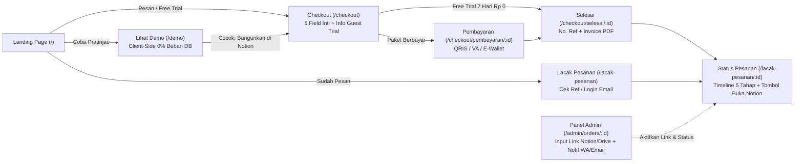
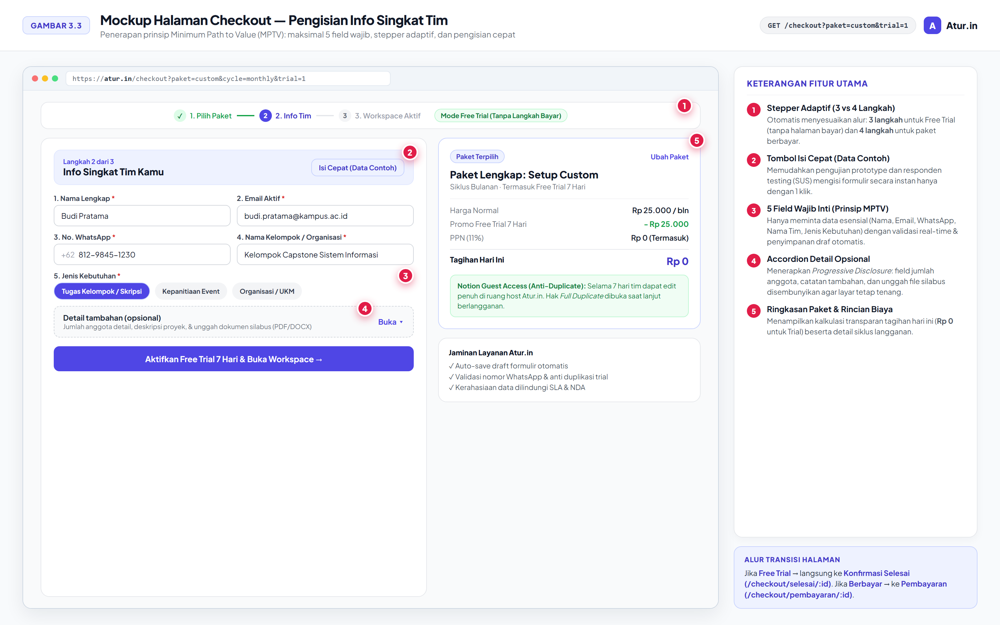
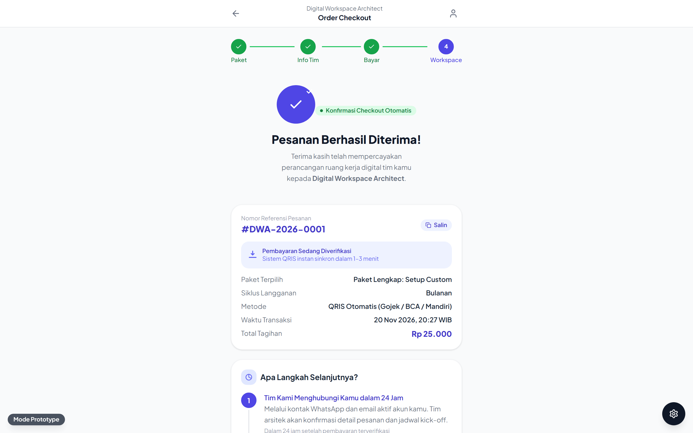

# 3.3 Hasil Mock Up & Penjelasan Fitur Sistem (Atur.in)

Subbab ini menyajikan rancangan antarmuka (*high-fidelity mock up*), daftar fitur utama, serta alur interaksi pengguna (*user flow*) aplikasi web **Atur.in (Digital Workspace Architect)**. Seluruh perancangan berlandaskan identitas Atur.in sebagai **layanan perancangan ruang kerja digital berbasis Notion dan Google Drive**, dengan tiga keunggulan arsitektur utama:

1. **Free Trial 7 Hari Anti-Jiplak (*Notion Guest Access*)**: Selama masa uji coba 7 hari (Rp 0), anggota tim diundang sebagai *Notion Guest (Can Edit)* di ruang *host* Atur.in dengan proteksi **Anti-Duplicate & Anti-Export**. Hak kepemilikan penuh (*Full Duplicate* ke akun Notion tim) dibuka setelah pembayaran.
2. **Simulasi Interaktif 100% *Client-Side* (`/demo`)**: Pratinjau interaktif berjalan penuh di memori/browser (`localStorage`) tanpa menulis ke database server sehingga **0% risiko *overload* server/database**, sekaligus memperagakan hierarki hak akses **3 tingkat (RBAC)** dan **Forum Koor Only**.
3. **Pemisahan Jalur UX yang Jernih (1 Halaman = 1 Tujuan)**: Memisahkan secara tegas menu **Lihat Demo (`/demo`)**, **Lacak Pesanan (`/lacak-pesanan`)**, **Checkout (`/checkout`)**, dan **Serah Terima Link Notion di Panel Admin (`/admin`)**.

---

## Ringkasan Matriks Fitur & Rute Aplikasi

| No | Halaman / Modul | Rute | Peran Pengguna | Fitur Utama |
| :-: | :--- | :--- | :--- | :--- |
| 1 | **Beranda (*Landing Page*)** | `/` | Pengunjung | Hero, pratinjau Kanban, masalah & solusi, 4 paket harga (*Bulanan* vs *Semesteran -20%*), FAQ *Notion Guest Trial*, & kontak WA. |
| 2 | **Checkout Info Tim** | `/checkout` | Pemesan / Ketua | Stepper adaptif (3 vs 4 langkah), 5 field wajib (*Minimum Path to Value*), accordion opsional, tombol *Isi Cepat*, & info *Notion Guest Access*. |
| 3 | **Pembayaran Multi-Metode** | `/checkout/pembayaran/:id` | Pemesan | Pilihan QRIS Instan, Virtual Account, & E-Wallet; *countdown timer*; *polling* status tiap 3 detik; simulasi bayar 1-klik. |
| 4 | **Konfirmasi Selesai & Invoice** | `/checkout/selesai/:id` | Pemesan | Nomor referensi unik (`DWA-2026-XXXX`), cetak **Invoice PDF resmi**, kartu akses **Workspace Notion & Drive**, & pintasan WA. |
| 5 | **Lacak Pesanan (Portal Bersih)** | `/lacak-pesanan` | Klien | Fokus tunggal: pencarian cepat via **Nomor Referensi** atau **Login Akun Email** untuk melihat riwayat pesanan & Link Notion. |
| 6 | **Status Pesanan *Real-Time*** | `/lacak-pesanan/:id` | Klien | Timeline 5 tahap (*auto-refresh* 30 detik), log aktivitas, banner upgrade Free Trial, & tombol **Buka Workspace di Notion**. |
| 7 | **Simulasi Interaktif (`/demo`)** | `/demo` | Pengunjung / Dosen | Sandbox 100% *client-side* (2 skenario: Kepanitiaan & Kelompok), **Ruang Utama 100% transparan**, **RBAC 3 tingkat**, **Forum Koor Only + Reply Thread**, Kanban Divisi, & Meja Pribadi. |
| 8 | **Panel Admin (*Backoffice*)** | `/admin/*` | Admin (JWT) | 8 kartu KPI *real-time*, manajemen & verifikasi pesanan, input **Link Notion & Drive + Tipe Akses**, serta tombol 1-klik **Notifikasi WA & Draft Email** ke klien. |

---

## 3.3.1 Arsitektur Alur Pengguna (*End-to-End User Flow*)

*Gambar 3.1 Arsitektur Alur Pengguna End-to-End Aplikasi Atur.in*

**Penjelasan Alur Utama:**
1. **Jalur Free Trial 7 Hari — Notion Guest Access (3 Langkah)**: Pengguna memilih paket *Setup Custom* (Rp 0) → mengisi 5 data inti di Checkout → masuk ke halaman Konfirmasi Selesai & Lacak Pesanan. Tim arsitek mengundang email pemesan sebagai **Notion Guest (Can Edit, Anti-Duplicate)** selama 7 hari. Jika cocok dan melunasi langganan, hak **Full Duplicate** langsung dibuka.
2. **Jalur Paket Berbayar (4 Langkah)**: Pengguna memilih paket berbayar → mengisi Info Tim → menyelesaikan pembayaran (QRIS, VA, atau E-Wallet) → mendapatkan Invoice PDF dan akses **Workspace Notion & Google Drive** penuh.
3. **Jalur Pratinjau (`/demo`) vs Pelacakan (`/lacak-pesanan`)**: Pengunjung yang belum memesan dapat mencoba simulasi interaktif 100% *client-side* di `/demo`, sedangkan klien yang sudah memesan mengakses `/lacak-pesanan` untuk memantau progres dan membuka Link Notion.
4. **Alur Serah Terima Multi-Kanal (Admin → Klien)**: Admin menempelkan Link Notion/Drive dan memilih tipe akses di `/admin/orders/:id`, lalu menekan tombol 1-klik **Kirim Notifikasi Selesai ke WA Klien** atau **Buka Draft Email**. Klien menerima notifikasi cepat dan selalu dapat membuka tautan permanennya melalui halaman Lacak Pesanan.

---

## 3.3.2 Mock Up Halaman Beranda (*Landing Page* & Pilihan Paket Harga)

*Gambar 3.2 Mock Up Halaman Beranda (Landing Page) dan Pilihan Paket Harga Atur.in*

| No | Elemen / Fitur | Penjelasan Fungsi |
| :-: | :--- | :--- |
| **1** | **Navigasi Terpisah & Anti-Bingung** | Memisahkan secara tegas tombol **Lihat Demo** (`/demo`), **Lacak Pesanan** (`/lacak-pesanan`), dan CTA utama **Mulai Gratis 7 Hari** (`#harga`). |
| **2** | **Hero Value Proposition & Dual CTA** | Menyampaikan solusi inti migrasi koordinasi dari grup chat ke Notion/Drive dengan dua jalur aksi: **Mulai Gratis 7 Hari** atau **Lihat Simulasi Interaktif**. |
| **3** | **Pratinjau Papan Kanban** | Memberi gambaran visual langsung struktur kerja kolaboratif (*Rencana*, *Dikerjakan*, *Selesai*) sebelum pengguna memesan. |
| **4** | **Toggle Siklus Langganan** | Membandingkan tarif **Bulanan** dan **Semesteran (6 bulan, hemat 20%)** secara dinamis. |
| **5** | **4 Kartu Paket Harga** | *Template Siap Pakai* (Rp 10.000/bln), *Setup Custom* (Rp 25.000/bln — **Paling Populer + Free Trial 7 Hari via Notion Guest Access**, patungan ~Rp 5.000/anak), *Kepanitiaan & Organisasi* (Rp 100.000/bln), dan *Paket Organisasi Pro* (Rp 499.000/bln). |

---

## 3.3.3 Mock Up Halaman Checkout — Pengisian Info Singkat Tim

*Gambar 3.3 Mock Up Halaman Checkout — Pengisian Info Singkat Tim*

| No | Elemen / Fitur | Penjelasan Fungsi |
| :-: | :--- | :--- |
| **1** | **Stepper Adaptif (3 vs 4 Langkah)** | Menampilkan **3 langkah** untuk Free Trial (*Pilih Paket → Info Tim → Workspace Aktif*) dan **4 langkah** untuk paket berbayar (*dengan langkah Bayar*). |
| **2** | **Tombol Isi Cepat (Data Contoh)** | Memudahkan pengujian prototype dan demonstrasi UAS mengisi 5 field wajib secara instan dalam 1 klik. |
| **3** | **5 Field Wajib Inti (*Minimum Path to Value*)** | Hanya meminta Nama Lengkap, Email Aktif, No. WhatsApp (`+62`), Nama Kelompok/Organisasi, dan Jenis Kebutuhan dengan validasi real-time & *auto-save draft*. |
| **4** | **Accordion Detail Opsional** | Menyembunyikan input opsional (jumlah anggota detail, deskripsi kebutuhan, unggah dokumen silabus) agar layar tetap ringkas (*Progressive Disclosure*). |
| **5** | **Ringkasan Paket & Info Notion Guest Access** | Menampilkan rincian biaya (**Rp 0 hari ini** untuk Trial) serta penjelasan transparan skema **Notion Guest Access (Anti-Duplicate) → Full Duplicate saat lunas**. |

---

## 3.3.4 Mock Up Halaman Pembayaran & Konfirmasi Pesanan Selesai

*Gambar 3.4 Mock Up Halaman Pembayaran (Kiri) dan Halaman Konfirmasi Selesai (Kanan)*

| No | Elemen / Fitur | Penjelasan Fungsi |
| :-: | :--- | :--- |
| **1** | **Countdown Timer Batas Pembayaran** | Menghitung mundur masa berlaku tagihan. Jika waktu habis, muncul status *Kedaluwarsa* dengan tombol perbarui tagihan. |
| **2** | **Pemilih 3 Metode Pembayaran** | Mendukung **QRIS Instan**, **Virtual Account** (bank nasional), dan **E-Wallet** (GoPay/OVO/DANA). |
| **3** | **Polling Status & Simulasi Bayar 1-Klik** | Memeriksa status transaksi ke server tiap 3 detik; pada mode prototype tersedia tombol **Simulasikan Bayar Lunas (1-Klik)** untuk keperluan demonstrasi. |
| **4** | **Bukti Transaksi & Cetak Invoice PDF** | Menampilkan nomor referensi unik (`DWA-2026-XXXX`) dengan tombol salin dan fitur cetak **Bukti Invoice Resmi (PDF)**. |
| **5** | **Kartu Akses Workspace Notion Tim** | Menampilkan badge status akses (*Akses Guest Trial 7 Hari — Anti-Duplicate* vs *Hak Milik Penuh*), pengingat login dengan email terdaftar, dan tombol **Buka Workspace di Notion** (atau pintasan `/demo` sambil menunggu setup). |

---

## 3.3.5 Mock Up Halaman Lacak Pesanan Bersih (`/lacak-pesanan`)

*Gambar 3.5 Mock Up Halaman Lacak Pesanan Bersih (/lacak-pesanan)*

| No | Elemen / Fitur | Penjelasan Fungsi |
| :-: | :--- | :--- |
| **1** | **Pencarian Cepat Nomor Referensi** | Klien cukup memasukkan nomor referensi (mis. `DWA-2026-0001`) untuk langsung membuka halaman Status Pesanan & Link Notion tanpa perlu login. |
| **2** | **Masuk / Daftar Akun Email** | Memungkinkan klien login dengan email untuk melihat seluruh daftar riwayat pesanan yang pernah dibuat. |
| **3** | **Kartu Riwayat Pesanan & Pintasan Notion** | Menampilkan status terkini setiap pesanan, tombol **Lihat Status & Link Notion**, serta tombol buka langsung ke Notion apabila tautan sudah aktif. |
| **4** | **Tautan Pintas ke Simulasi (`/demo`)** | Pengunjung yang belum memesan diarahkan dengan ramah ke halaman terpisah `/demo` agar tidak mencampuradukkan fungsi pelacakan dengan mode demo. |

---

## 3.3.6 Mock Up Halaman Lacak Status Pesanan (*Real-Time*)

*Gambar 3.6 Mock Up Halaman Lacak Status Pesanan Real-Time (/lacak-pesanan/:id)*

| No | Elemen / Fitur | Penjelasan Fungsi |
| :-: | :--- | :--- |
| **1** | **Banner Masa Aktif Free Trial & Upgrade** | Menampilkan tanggal berakhirnya Free Trial 7 Hari serta tombol pintas **Bayar & Aktifkan Langganan Penuh** untuk membuka hak *Full Duplicate*. |
| **2** | **Ringkasan Referensi & Refresh Manual** | Memuat nomor referensi `DWA-2026-XXXX`, lencana status aktif, detail paket, tombol salin, dan muat ulang manual. |
| **3** | **Timeline 5 Tahap Real-Time** | Melacak progres otomatis (*auto-refresh* setiap 30 detik): `Menunggu Pembayaran → Pembayaran Diterima → Diverifikasi → Proses Setup → Selesai`. |
| **4** | **Riwayat Aktivitas (*Audit Trail*)** | Mencatat kronologi pembaruan status dan pengiriman link workspace oleh Admin beserta stempel waktu WIB. |
| **5** | **Kartu Akses Workspace Notion & Drive** | Pusat akses permanen berisi badge tipe akses, panduan login email terdaftar (untuk *Notion Guest*), tombol **Buka Workspace di Notion ↗**, tombol **Folder Google Drive**, dan bantuan WhatsApp. |

---

## 3.3.7 Mock Up Simulasi Interaktif (`/demo`) — Hierarki 3 Tingkat (RBAC) & Ruang Utama Transparan

Halaman `/demo` berjalan **100% *client-side* di browser** (`localStorage`, 0 request database) sehingga tidak menimbulkan beban server. Simulasi ini memperagakan arsitektur **Role-Based Access Control (RBAC) 3 tingkat** yang dibangun Atur.in di Notion:

| Peran (*Role*) | Ruang Utama (Paparan Progres Tiap Divisi) | Forum Koor Only (Diskusi Lintas Koor) | Ruang Divisi Sendiri (Kanban) | Ruang Divisi Lain (Edit Kanban) | Meja Kerja Pribadi |
| :--- | :---: | :---: | :---: | :---: | :---: |
| **Ketua Pelaksana / Ketua Kelompok** | **Transparan Penuh** + Kelola Semua | **Akses Penuh** | **Semua Divisi** | **Akses Penuh** | **Akses Penuh** |
| **Koordinator Divisi (Koor)** | **Transparan Penuh** (Pantau Semua) | **Akses Penuh (Eksklusif)** | **Akses Penuh** | Terkunci (`🔒`) | **Akses Penuh** |
| **Anggota Divisi** | **Transparan Penuh** (*Mode Pantau*) | Terkunci (`🔒`) | **Akses Penuh** | Terkunci (`🔒`) | **Akses Penuh** |

*Gambar 3.7 Mock Up Simulasi Interaktif (/demo) — Ruang Utama 100% Transparan & Sidebar RBAC 3 Tingkat*

| No | Elemen / Fitur | Penjelasan Fungsi |
| :-: | :--- | :--- |
| **1** | **Switcher Skenario & Simulasi Peran (RBAC)** | Pengguna/dosen dapat berganti skenario (*Kepanitiaan* vs *Kelompok*) dan peran (*Ketua → Koor → Anggota*) untuk menguji perubahan hak akses secara langsung. |
| **2** | **Sidebar Navigasi Terproteksi** | Menampilkan **Ruang Utama**, **Forum Koor Only** (`Koor+` / `🔒`), **Meja Kerja Saya**, serta daftar **Ruang Divisi** dengan ikon gembok (`🔒`) pada ruang di luar wewenang peran aktif. |
| **3** | **Banner Transparansi *Client-Side*** | Menegaskan bahwa simulasi berjalan lokal di browser sebagai pratinjau struktur Notion & Drive, lengkap dengan tombol CTA **Bangunkan di Notion (Gratis 7 Hari)**. |
| **4** | **Kartu Paparan Progres 100% Transparan** | Setiap kartu divisi di Ruang Utama menampilkan *progress bar* %, ringkasan capaian, dan **rincian daftar tugas tiap divisi** secara terbuka tanpa label terkunci agar seluruh divisi saling mengetahui progres satu sama lain. |
| **5** | **Akses Kelola vs Mode Pantau** | Divisi yang sesuai wewenang menampilkan tombol **Kelola Ruang Divisi →**, sedangkan divisi lain menampilkan label **Transparan · Mode Pantau Progres** agar integritas tugas tetap terjaga. |

---

## 3.3.8 Mock Up Forum Koor Only (Reply Thread) & Ruang Divisi / Meja Pribadi

*Gambar 3.8 Mock Up Forum Koor Only (Reply Thread ala Notion Comments) & Ruang Divisi / Meja Pribadi*

| No | Elemen / Fitur | Penjelasan Fungsi |
| :-: | :--- | :--- |
| **1** | **Header Eksklusif Forum Koor Only** | Hanya dapat diakses oleh **Ketua Pelaksana** dan **Koordinator Divisi** untuk membahas keputusan rapat strategis & eskalasi lintas divisi (terkunci `🔒` bagi Anggota). |
| **2** | **Form Posting Agenda / Keputusan Rapat** | Ketua dan Koor dapat menambahkan topik bahasan baru secara terstruktur per kategori (*Keputusan Rapat*, *Eskalasi Lintas Divisi*). |
| **3** | **Reply Thread (Ala *Notion Comments*)** | Setiap topik dilengkapi kolom balasan komentar interaktif antar-Koor & Ketua serta tombol **Tandai Selesai Dibahas**, sehingga diskusi terkelompok rapi per topik dan tidak tenggelam di grup WhatsApp. |
| **4** | **Kanban Internal Divisi & Meja Pribadi** | Anggota fokus mengeksekusi tugas di papan Kanban divisinya sendiri (*Rencana → Dikerjakan → Revisi & review → Selesai*) serta mencatat *checklist* harian di **Meja Kerja Pribadi**. |
| **5** | **Layar Proteksi Akses (*Access Denied*)** | Jika Anggota mencoba membuka *Forum Koor Only* atau ruang internal divisi lain, sistem menampilkan layar proteksi ramah dengan pintasan kembali ke **Ruang Utama** atau **Divisi Saya**. |

---

## 3.3.9 Mock Up Panel Admin — Dashboard KPI, Serah Terima Link Notion, & Notifikasi Otomatis

*Gambar 3.9 Mock Up Panel Admin — Dashboard KPI, Serah Terima Link Notion/Drive, & Notifikasi Otomatis WA/Email*

| No | Elemen / Fitur | Penjelasan Fungsi |
| :-: | :--- | :--- |
| **1** | **Navigasi Backoffice Terproteksi (`AdminGuard`)** | Dilindungi autentikasi JWT khusus role Admin/Superadmin untuk mengakses *Dashboard*, *Pesanan*, *Pengguna*, dan *Leads*. |
| **2** | **8 Kartu Metrik KPI Real-Time** | Memantau *Total Pesanan*, *Total Revenue*, *Free Trial Aktif*, *Menunggu Bayar*, *Proses Setup*, *Selesai*, *Total Pengguna*, dan *Leads Masuk* (*auto-refresh* 30 detik). |
| **3** | **Tabel Pesanan & Kontrol Status** | Admin memverifikasi pembayaran dan memperbarui status pengerjaan (`Diverifikasi → Proses Setup → Selesai`) yang otomatis memperbarui Timeline klien. |
| **4** | **Form Serah Terima Link Notion & Drive** | Pada detail pesanan (`/admin/orders/:id`), Admin menempelkan **Link Notion Workspace**, **Link Google Drive**, dan memilih tipe hak akses (*Akses Guest Free Trial 7 Hari — Anti-Duplicate* vs *Hak Milik Penuh — Bisa Duplicate*). |
| **5** | **Tombol 1-Klik Notifikasi WA & Draft Email** | Setelah link disimpan, Admin cukup menekan 1 tombol untuk mengirim pesan WhatsApp atau membuka draft Email otomatis ke klien berisi nomor referensi, status akses Notion, dan tautan halaman Lacak Pesanan. |
